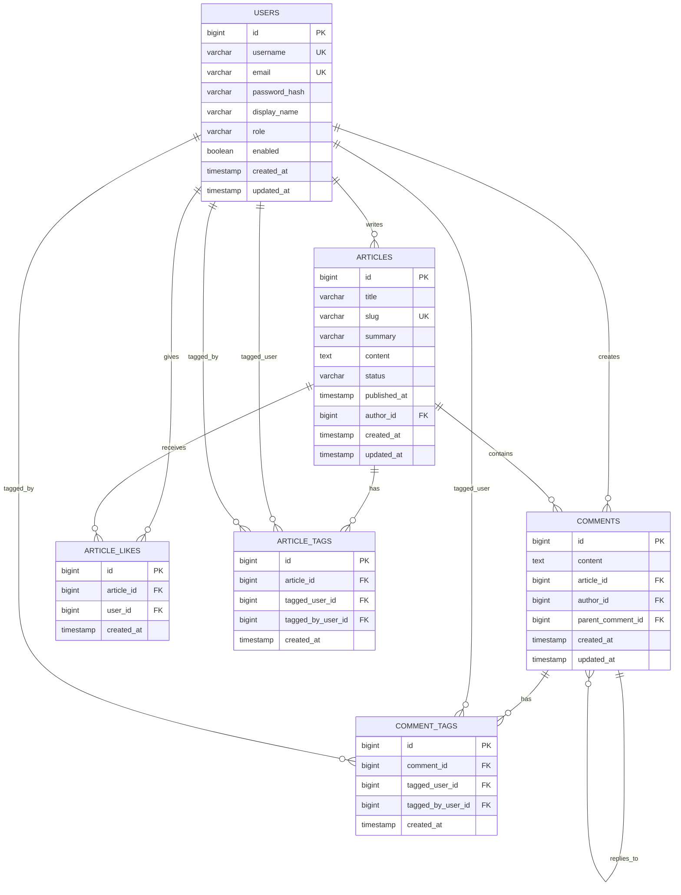

# Article Publishing Platform - Entity Relationship Diagram

## Database: PostgreSQL

The application uses six main entities: users, articles, comments, article_likes, article_tags and comment_tags.

## Relationships and Constraints

- One user can create multiple articles.
- One article can contain multiple comments.
- Comments support nested replies through `parent_comment_id`.
- One user can like an article only once.
- Users can be tagged in articles and comments.
- `tagged_user_id` identifies the mentioned user.
- `tagged_by_user_id` identifies the user who created the tag.
- Article slugs, usernames and email addresses are unique.
- Like and tag relationships have unique constraints to prevent duplicate records.
