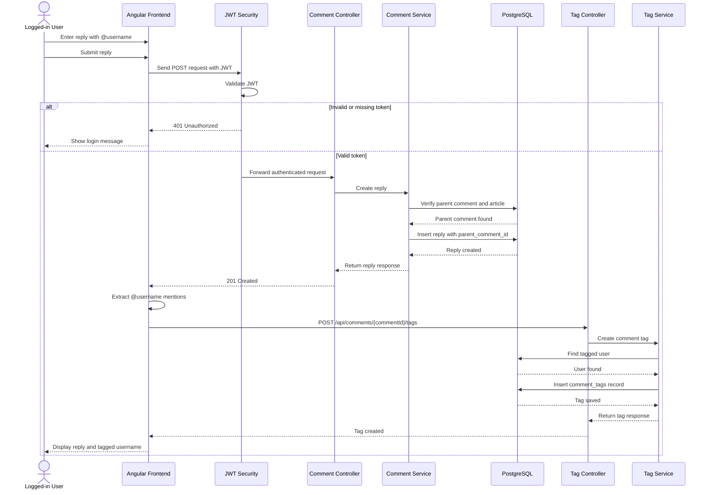

# Sequence Diagram - Comment Reply with User Tagging

This diagram describes how an authenticated user replies to an existing comment and tags another registered user.

## Flow Summary

1. User submits a reply containing an @username mention.
2. JWT authentication validates the request.
3. Comment service verifies the parent comment and article.
4. Reply is saved with its parent comment reference.
5. Angular extracts mentioned usernames.
6. Tag API creates the corresponding comment tag.
7. The frontend displays the saved reply.
